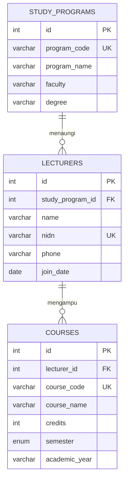

# Lecturer Management FPMIPA UPI – Sistem Informasi Pengelolaan Dosen dan Kurikulum Akademik

Aplikasi web berbasis PHP Native murni yang dibangun dengan arsitektur **Model-View-Controller (MVC)** dan pendekatan berorientasi objek (*Object-Oriented Programming* / OOP) untuk mengelola data program studi, profil dosen, dan mata kuliah kurikulum perguruan tinggi. Aplikasi terhubung ke basis data MySQL `tp_mvc25` menggunakan PDO (*PHP Data Objects*) dengan *Prepared Statements* penuh untuk menjamin keamanan dari serangan *SQL Injection*. Sistem mendukung relasi multi-tabel (*Foreign Key Constraints*), perhitungan agregasi jumlah dosen pengampu secara dinamis, formulir validasi komprehensif, proteksi keamanan CSRF (*Cross-Site Request Forgery*), pola *Post-Redirect-Get* (PRG), serta antarmuka responsif berbasis Bootstrap 5 dengan tata letak *Sticky Footer* yang konsisten di batas bawah layar.

---

## 1. Desain dan Fungsi Program

Antarmuka **Lecturer Management FPMIPA UPI** dirancang secara bersih, modern, dan responsif menggunakan kerangka kerja Bootstrap 5 lokal. Sistem mengelola 3 entitas utama yang saling berelasi:

- **Program Studi (`study_programs`):** Data unit pengelola akademik perguruan tinggi mencakup kode prodi unik (misal `D5451`), nama program studi, fakultas (default `FPMIPA`), serta jenjang pendidikan (`D3`, `S1`, `S2`, `S3`). Tabel ini juga secara otomatis menampilkan jumlah dosen yang aktif bernaung di bawah prodi tersebut melalui agregasi query `LEFT JOIN`.
- **Dosen (`lecturers`):** Data identitas pengajar perguruan tinggi yang mencakup nama lengkap beserta gelar akademik, Nomor Induk Dosen Nasional (NIDN unik), kontak telepon/WhatsApp, tanggal mulai bergabung, serta berelasi *Foreign Key* ke Program Studi (`study_program_id`).
- **Mata Kuliah (`courses`):** Data kurikulum akademik yang mencakup kode mata kuliah unik (misal `IK101`), nama mata kuliah, bobot SKS (1 s.d. 6 SKS), semester penawaran (`Ganjil` / `Genap`), tahun akademik (format `YYYY/YYYY`), serta berelasi *Foreign Key* ke Dosen Pengampu (`lecturer_id`).

### Diagram Relasi Entitas (ERD)



### Fitur Utama

- **Create:** Menambahkan data baru pada ketiga tabel (Program Studi, Dosen, dan Mata Kuliah) dengan sanitasi input otomatis dan validasi integritas data.
- **Read:** Menampilkan data dari basis data ke tabel web dengan nomor urut dinamis, relasi data multi-tabel via query `INNER JOIN` dan `LEFT JOIN`, serta *empty state* yang informatif jika data belum tersedia.
- **Update:** Memperbarui data entitas terpilih melalui formulir edit yang terisi otomatis (*pre-populated*) dengan nilai lama tanpa mengubah ID kunci utama.
- **Delete:** Menghapus data dengan dialog konfirmasi keamanan JavaScript (`confirm()`). Permintaan dikirim via metode POST dengan token CSRF untuk mencegah eksekusi sepihak via URL.
- **Foreign Key Relational Dropdown:** Pemilihan program studi pada form dosen dan pemilihan dosen pengampu pada form mata kuliah diambil langsung secara dinamis dari database lengkap beserta atribut relasinya.
- **Agregasi Dosen Otomatis:** Halaman Program Studi menampilkan total dosen yang terdaftar di masing-masing prodi menggunakan fungsi SQL `COUNT(l.id)` dan `GROUP BY`.
- **Proteksi Integritas Referensial (Cascade & Restrict Safeguard):** Sistem menangani *Foreign Key Constraint* pada basis data; program studi yang masih menaungi dosen atau dosen yang masih mengampu mata kuliah dilindungi dari penghapusan yang tidak sengaja dengan notifikasi peringatan yang jelas.
- **Sticky Footer Responsif:** Menggunakan flexbox utility Bootstrap 5 (`d-flex flex-column min-vh-100` pada `body`, `flex-grow-1` pada `main`, dan `mt-auto` pada `footer`) sehingga footer selalu berada di batas terbawah layar pada halaman dengan sedikit konten, dan berada di bawah konten secara alami saat halaman panjang.
- **Keamanan Prepared Statement:** 100% eksekusi query SQL menggunakan parameter binding PDO (`$statement->prepare()` dan `$statement->execute()`) untuk menutup celah *SQL Injection*.
- **Proteksi Token CSRF:** Seluruh formulir perubahan data menyertakan token acak 32-byte kriptografis (`bin2hex(random_bytes(32))`) yang diverifikasi pada siklus request.
- **Pola Post-Redirect-Get (PRG) & Flash Messages:** Mengalihkan halaman setelah aksi POST berhasil dan menampilkan notifikasi status satu kali (*flash message*) menggunakan Bootstrap Alert yang dapat ditutup (*dismissible*).

---

## 2. Teknologi yang Digunakan

- **Bahasa Pemrograman:** PHP (Versi 8.x - Native OOP dengan arsitektur MVC murni tanpa framework)
- **Antarmuka (GUI):** HTML5, CSS3, Bootstrap 5.0.2 (Asset lokal offline: `bootstrap.min.css` dan `bootstrap.bundle.min.js`)
- **Basis Data:** MySQL / MariaDB (Nama Basis Data: `tp_mvc25`)
- **Akses Basis Data:** PDO (*PHP Data Objects*) dengan pola *Singleton* dan *Prepared Statement*
- **Web Server Lokal:** Apache melalui XAMPP
- **Peramban Web:** Google Chrome / Microsoft Edge / Mozilla Firefox
- **Text Editor / IDE:** Visual Studio Code

---

## 3. Penjelasan Alur Program

1. **Inisialisasi & Front Controller (`index.php`):**
   - Setiap permintaan HTTP yang masuk diarahkan ke berkas utama `index.php`.
   - Sesi PHP (`session_start()`) dimulai jika belum aktif untuk mendukung *flash message* dan CSRF token.
   - Mengambil parameter query string `page` (default: `lecturers`), `action` (default: `index`), dan `id` (integer positif).
2. **Routing Whitelist & Proteksi Metode:**
   - Memeriksa apakah `page` terdaftar dalam daftar rute yang sah (`$routes`). Jika tidak, server mengembalikan status 404.
   - Memastikan `action` terdaftar dalam daftar aksi yang diizinkan (`index`, `create`, `store`, `edit`, `update`, `delete`).
   - Memastikan aksi manipulasi data (`store`, `update`, `delete`) wajib dikirim melalui metode HTTP POST (status 405 jika dipanggil via GET).
3. **Koneksi Database Singleton (`models/Database.php`):**
   - Model menginisialisasi koneksi PDO ke database MySQL `tp_mvc25` menggunakan kredensial dari `config.php`.
   - Pola *Singleton* menjamin koneksi hanya dibuat satu kali per siklus *request* untuk menghemat sumber daya memori server.
4. **Alur Menampilkan Data (Read / Index):**
   - Controller memanggil method `getAll()` pada Model yang bersangkutan.
   - Model menjalankan query SQL dengan relasi `JOIN` (`INNER JOIN` untuk menampilkan nama dosen & prodi di tabel mata kuliah; `LEFT JOIN` dan `COUNT` untuk menghitung dosen di tabel prodi).
   - Controller meneruskan data ke layer View (`*View::index()`), yang kemudian memanggil `Template::render()`.
   - `Template::render()` mengekstrak data ke variabel lokal, memuat `templates/layouts/header.php`, berkas template indeks yang dituju, dan `templates/layouts/footer.php`.
5. **Alur Penambahan Data (Create & Store):**
   - Pengguna menekan tombol "Tambah". Controller memanggil aksi `create()`, mengambil data relasi untuk *dropdown* (jika ada), lalu menampilkan formulir input.
   - Pengguna mengisi data dan mengirimkan form via POST ke URL target `store`.
   - Controller melakukan sanitasi (pembersihan spasi via `trim()`, kapitalisasi kode via `strtoupper()`, dan validasi tipe via `filter_var()`).
   - Controller memvalidasi aturan bisnis (panjang karakter, format regex nomor telepon, format tanggal objek `DateTime`, batas SKS 1–6, opsi semester, dan rentang tahun akademik `YYYY/YYYY`).
   - Jika validasi lolos, method `create()` pada Model dipanggil dengan *Prepared Statement*. Jika gagal atau terjadi duplikasi kunci unik (kode galat PDO `23000`), pesan galat disimpan ke *flash message* dan pengguna dialihkan kembali via PRG.
6. **Alur Pembaruan Data (Edit & Update):**
   - Pengguna menekan tombol "Edit" pada baris data. Controller memanggil aksi `edit($id)`, mencari rekaman via `getById($id)`.
   - Formulir menampilkan data lama (*pre-filled*). Saat dikirim ulang via POST ke aksi `update($id)`, controller memvalidasi input dan memperbarui baris data pada database melalui method `update()` di Model.
7. **Alur Penghapusan Data (Delete):**
   - Pengguna menekan tombol "Hapus" yang dilindungi dialog konfirmasi JavaScript.
   - Form mengirimkan request POST dengan menyertakan token CSRF.
   - Controller memanggil method `delete($id)`. Jika data memiliki relasi foreign key aktif (misal prodi yang masih memiliki dosen), blok *try-catch* menangkap *PDOException* dan memberikan pesan peringatan edukatif tanpa menyebabkan aplikasi mogok (*crash*).

---

## 4. Dokumentasi Demonstrasi

Video demonstrasi pengujian program mencakup pengujian fungsionalitas seluruh fitur CRUD pada ketiga entitas relasional (Program Studi, Dosen, dan Mata Kuliah), relasi bertingkat *Foreign Key*, validasi data, proteksi integritas hapus data, serta tampilan *Sticky Footer* yang responsif:

- **Tautan Video YouTube:** [Tonton Video Demo](https://youtu.be/r1CiucfVI8w)

*(Catatan: Tautan video di atas dapat diperbarui dengan URL rekaman layar resolusi tinggi setelah proses perekaman selesai).*

---

## 5. Struktur Project

```text
tp_mvc25/
├── assets/
│   ├── css/
│   │   └── bootstrap.min.css
│   └── js/
│       ├── bootstrap.bundle.min.js
│       ├── bootstrap.min.js
│       ├── jquery.min.js
│       └── popper.min.js
├── controllers/
│   ├── CourseController.php
│   ├── LecturerController.php
│   └── StudyProgramController.php
├── models/
│   ├── Course.php
│   ├── Database.php
│   ├── Lecturer.php
│   └── StudyProgram.php
├── templates/
│   ├── courses/
│   │   ├── form.php
│   │   └── index.php
│   ├── layouts/
│   │   ├── footer.php
│   │   └── header.php
│   ├── lecturers/
│   │   ├── form.php
│   │   └── index.php
│   └── study_programs/
│       ├── form.php
│       └── index.php
├── views/
│   ├── CourseView.php
│   ├── LecturerView.php
│   ├── StudyProgramView.php
│   └── Template.php
├── config.php
├── database.sql
├── index.php
└── README.md
```

---

## 6. Penjelasan Class dan File

### `config.php`
Menyimpan konfigurasi sentral aplikasi meliputi konstanta kredensial basis data (`DB_HOST`, `DB_NAME`, `DB_USER`, `DB_PASS`), nama aplikasi (`APP_NAME`), direktori absolut proyek (`ROOT_PATH`), serta penentuan alamat URL dasar (`BASE_URL`) secara otomatis mengikuti letak folder pada server lokal Apache/XAMPP.

### `index.php`
Titik masuk utama (*Front Controller*) aplikasi. Mengatur sesi PHP, memuat dependensi, memetakan query string URL (`page`, `action`, `id`) menggunakan *whitelist router*, membatasi metode HTTP untuk mencegah manipulasi data via GET, menginstansiasi controller yang sesuai, dan mengeksekusi metode yang diminta.

### `models/Database.php`
Mengelola koneksi ke server MySQL menggunakan PDO dengan pola desain *Singleton*. Mengonfigurasi penanganan kesalahan berbasis exception (`ATTR_ERRMODE => ERRMODE_EXCEPTION`), menyetel format pengembalian data default ke array asosiatif (`ATTR_DEFAULT_FETCH_MODE => FETCH_ASSOC`), dan mematikan emulasi prepared statement (`ATTR_EMULATE_PREPARES => false`) demi keamanan maksimal.

### `models/StudyProgram.php`
Model untuk tabel `study_programs`. Menyediakan method `getAll()` yang menggabungkan query `LEFT JOIN` ke tabel dosen untuk menghitung total dosen pengampu per program studi, method `getById()` untuk mengambil detail satu prodi, serta method `create()`, `update()`, dan `delete()`.

### `models/Lecturer.php`
Model untuk tabel `lecturers`. Method `getAll()` menjalankan query `INNER JOIN` dengan tabel `study_programs` untuk menyertakan nama dan kode prodi. Method `getAllForDropdown()` menyajikan data ringkas (ID, nama, NIDN) untuk efisiensi pengisian opsi select pada form mata kuliah, serta method `create()`, `update()`, dan `delete()`.

### `models/Course.php`
Model untuk tabel `courses`. Method `getAll()` mengimplementasikan *multilevel join* (`courses` &rarr; `lecturers` &rarr; `study_programs`) untuk menyajikan identitas mata kuliah lengkap dengan nama dosen, NIDN, dan prodi pengampu dalam satu query. Dilengkapi method `create()`, `update()`, dan `delete()`.

### `controllers/StudyProgramController.php`
Mengelola alur navigasi dan aksi entitas program studi. Bertanggung jawab memvalidasi kode prodi, nama, fakultas, jenjang pendidikan (`D3`, `S1`, `S2`, `S3`), menangani galat duplikasi kode (kode PDO 23000), mengelola pesan notifikasi sesi (*flash message*), dan menangani pengalihan halaman (*redirect*).

### `controllers/LecturerController.php`
Mengelola alur navigasi dan aksi entitas dosen. Bertanggung jawab memvalidasi identitas pengajar (nama, NIDN, nomor telepon dengan regex, keabsahan tanggal bergabung via objek `DateTime`, dan pengecekan keberadaan ID prodi di database), serta menangani proteksi penghapusan jika dosen masih terikat pada mata kuliah.

### `controllers/CourseController.php`
Mengelola alur navigasi dan aksi entitas mata kuliah. Bertanggung jawab memvalidasi pilihan dosen pengampu, kode unik, nama mata kuliah, batasan beban SKS (1 s.d. 6 SKS), semester penawaran, serta format dan keterurutan tahun akademik (`YYYY/YYYY`).

### `views/Template.php`
Mesin pembungkus tampilan (*View Engine*). Menerima nama berkas template dan data dari controller, mengekstrak variabel dengan proteksi `EXTR_SKIP`, mengamankan dari celah *Path Traversal* (LFI) via fungsi `realpath()`, menghasilkan token CSRF acak, mengonsumsi notifikasi *flash message*, serta merender secara berurutan: `header.php` &rarr; berkas konten &rarr; `footer.php`.

### `views/*View.php` (`StudyProgramView`, `LecturerView`, `CourseView`)
Kelas pembungkus (*View Wrapper*) statis yang mengisolasi pemanggilan template untuk masing-masing modul (`index` dan `form`), menjaga pemisahan tanggung jawab (*separation of concerns*) antara controller dan struktur berkas template.

### `templates/layouts/header.php` & `footer.php`
Tata letak global aplikasi. `header.php` memuat metadata dokumen, stylesheet Bootstrap lokal, navigasi navbar responsif, penampung alert notifikasi flash, serta pembuka flexbox (`body class="d-flex flex-column min-vh-100"` dan `main class="container py-4 flex-grow-1"`). `footer.php` memuat penutup kontainer, elemen footer dengan `mt-auto` (*sticky footer*), teks hak cipta dinamis, dan pemuatan skrip JS Bootstrap Bundle.

### `templates/*/{index,form}.php`
Berkas tampilan modular berbasis entitas:
- `index.php`: Menyajikan tabel data responsif dengan penomoran urut, badge informasi, tombol edit, form hapus dengan input hidden token CSRF, dan tampilan kosong (*empty state*).
- `form.php`: Formulir serbaguna (*reusable*) yang dapat beralih secara otomatis antara mode penambahan data baru atau pengubahan data lama (*edit pre-filled*) lengkap dengan token CSRF dan opsi dropdown relasional.

### `database.sql`
Berkas skrip SQL lengkap yang memuat perintah DDL pembuatan basis data `tp_mvc25`, tabel `study_programs`, `lecturers`, dan `courses` dengan *Foreign Key Constraints* dan *Check Constraints*, serta perintah DML data awal (*seeding*) yang mencakup 11 program studi, 6 dosen pengajar, dan 12 mata kuliah siap uji.
